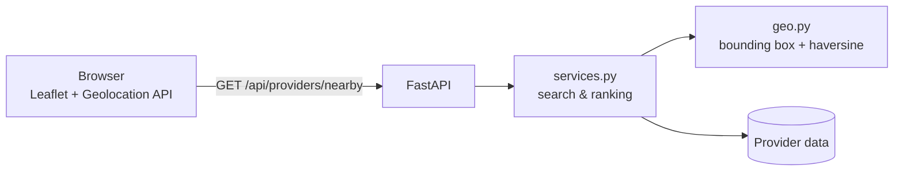

# 📍 Geolocalized Services MVP

> Find trusted home-service providers (plumbers, electricians, locksmiths, cleaners) near you on an interactive map, powered by a fast geospatial search API.


## The problem

When a pipe bursts or you get locked out, you need someone **close** and **available** right now. Generic directories list providers alphabetically or by paid ranking, with no sense of distance or current availability.

## The solution

A minimum viable product for a location-based services marketplace:

- **Browser geolocation**: one click centres the search on the user's real position (falls back to a demo location in Passau).
- **Radius and category filters** with instant results on an OpenStreetMap map.
- **Ranking by distance, then rating**, hiding providers that are currently unavailable.
- **Documented REST API** (OpenAPI / Swagger UI generated automatically by FastAPI).

## Architecture



| Module | Responsibility |
|---|---|
| `app/geo.py` | Haversine distance, bounding-box pre-filter, coordinate validation |
| `app/services.py` | Framework-independent search logic: filtering, ranking, limits |
| `app/main.py` | HTTP layer: query validation, error mapping, CORS, static frontend |
| `static/index.html` | Single-page map UI (no build step) |

**Key design decisions**

- **Two-step geospatial search**: a cheap bounding-box filter discards most candidates before the exact haversine distance is computed. The same pattern maps directly to an indexed SQL query or to PostGIS later.
- **Business logic decoupled from the framework**: `services.py` has no FastAPI imports, so it is unit-tested in isolation and reusable from workers or CLIs.
- **Config by environment variables**, with no secrets in the code; CORS origins are configurable.
- **Container-ready**: a slim Docker image running as a non-root user.

## API

| Method | Endpoint | Description |
|---|---|---|
| `GET` | `/api/health` | Health check |
| `GET` | `/api/categories` | Available service categories |
| `GET` | `/api/providers/nearby?lat=&lng=&radius_km=&category=&only_available=&limit=` | Nearby providers sorted by distance |

Interactive docs: <http://localhost:8000/docs>

## Getting started

**Prerequisites:** Python 3.12 (or Docker).

```bash
git clone https://github.com/leandromerov/geolocalized-services-mvp.git
cd geolocalized-services-mvp
python -m venv .venv && source .venv/bin/activate   # Windows: .venv\Scripts\activate
pip install -r requirements.txt
cp .env.example .env
uvicorn app.main:app --reload
```

Open <http://localhost:8000> and click **Use my location**.

### With Docker

```bash
docker build -t geolocalized-services-mvp .
docker run -p 8000:8000 --env-file .env geolocalized-services-mvp
```

### Run the tests

```bash
pytest -q
```

The suite covers the geospatial maths, the search/ranking logic and the HTTP layer (FastAPI `TestClient`). CI runs it on every push and also builds the Docker image.

## Roadmap

- [ ] PostgreSQL + PostGIS storage with spatial indexes
- [ ] Provider sign-up and JWT authentication
- [ ] Booking requests and real-time availability
- [ ] Reviews and ratings

## Author

**Leandro Romero Villalobos** · IT Analyst & Programmer · Passau, Germany
[GitHub](https://github.com/leandromerov) · leandroromerovillalobos@gmail.com

## License

[MIT](LICENSE)
